## 01 / 颜色可以再多一点

*PEOPLE & PERSONAL STYLE*

### Peggy Gou.

Peggy Gou 关注很久了，最近才发现她在伦艺的 LCF 读过书。之前居然一直不知道。

她的穿搭好看的地方，是很多单件放在一起都有点冲。亮红色西装、白衬衫、黑领带，再加红色镜框，领带也没有规规矩矩地收好。红色已经很响了，她还要加红。一身粉色那套又换了方法，衬衫、帽子、大包都粉，颜色接近，材质和形状不一样，看着一点也不腻。

还有紫外套里露出一截亮绿、蓝头发配蓝色包。她很知道哪些地方可以再多一点。看这些照片会想穿颜色，会觉得今天也可以穿得很有能量。

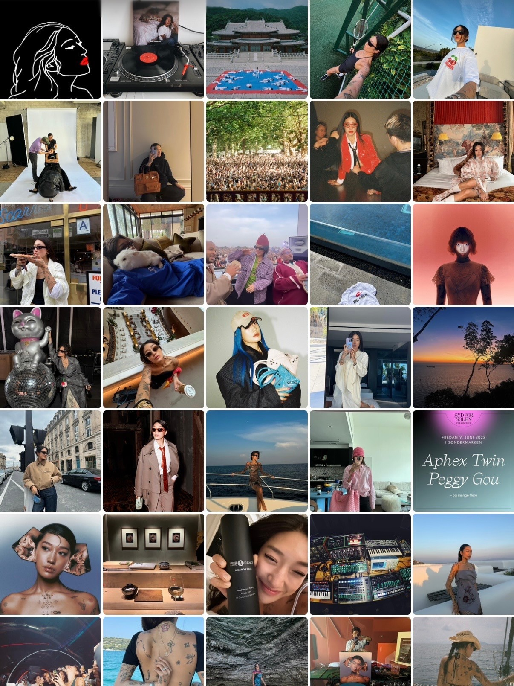

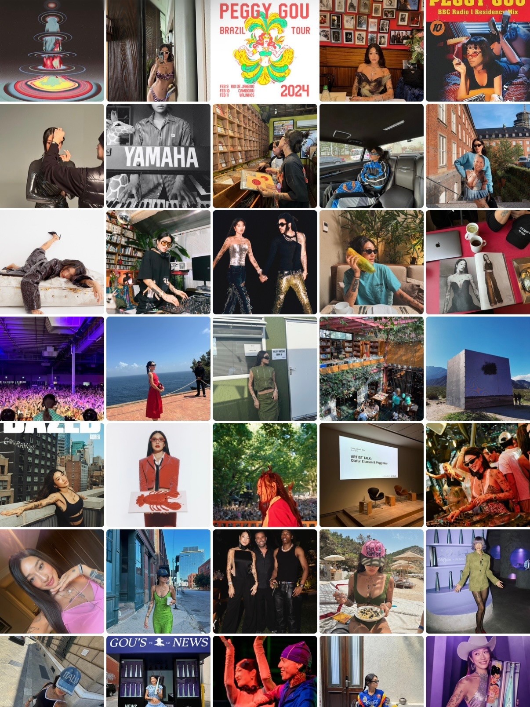

*PERSONAL STYLE / CONTINUED*

### 黄宣，不只穿衣服。

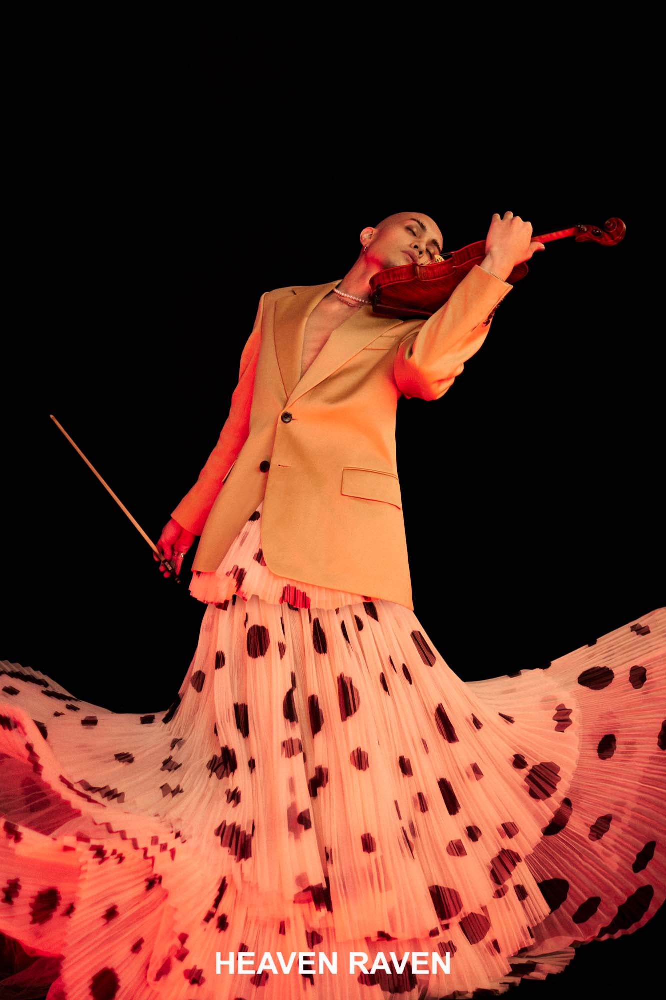

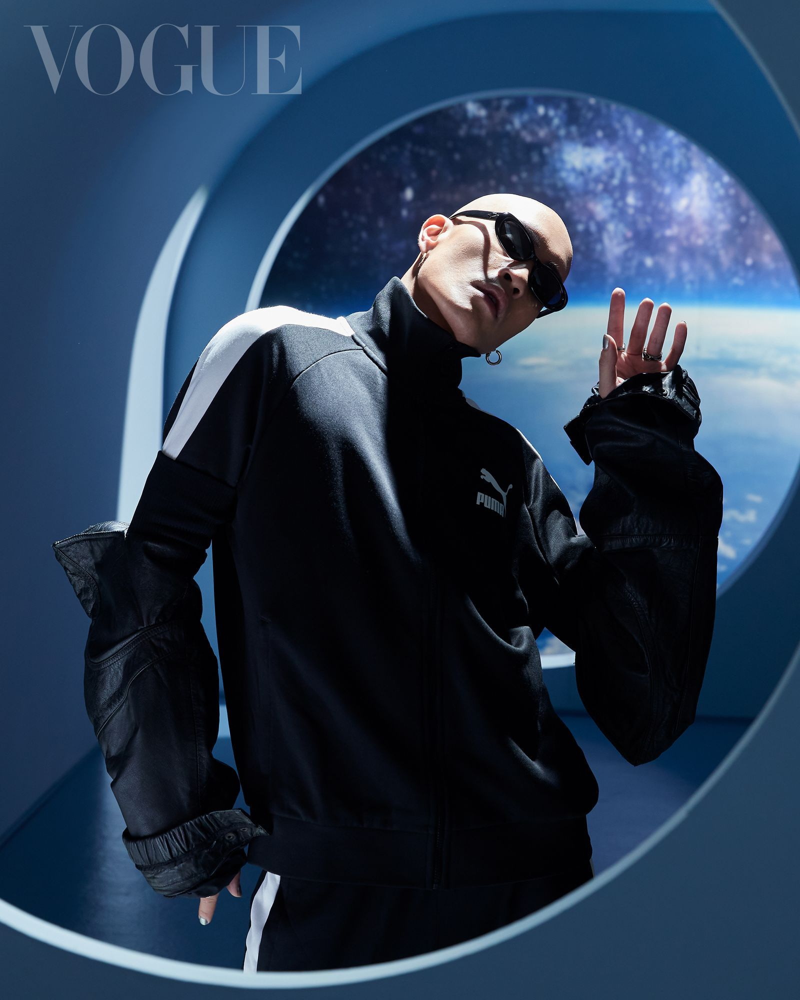

黄宣的穿搭也很有风格。这套杏黄色西装，下面不是一条规矩的裤子，而是一大片波点褶裙。上面有西装的肩线和翻领，下面却松开、铺出去，硬的和软的叠在一起。裙摆这么大，还拿着一把红色小提琴，整张照片都很夸张。

另一套是黑白运动上衣，袖子外面又套了皮质袖套。胳膊一下膨起来，运动服原来的利落轮廓被改掉了。西装配大裙子，运动上衣配皮袖套，都是熟悉的衣服，但他很会把它们搭得不一样。

本来想去海口的 Mañana 明日公园看黄宣，结果忘了抢票。

*PERSONAL STYLE / CONTINUED*

### 一件黑色拉链西装

这个月居然在 SONG OF SONG 买了一件黑色拉链西装。

完全看不出这个牌子惯常的华丽感，剪裁却实在太棒了。黑色、拉链，已经足够，不需要再加什么。逛到一个原本没想到的牌子，发现它竟然有一件这么对的衣服，这种意外很开心。

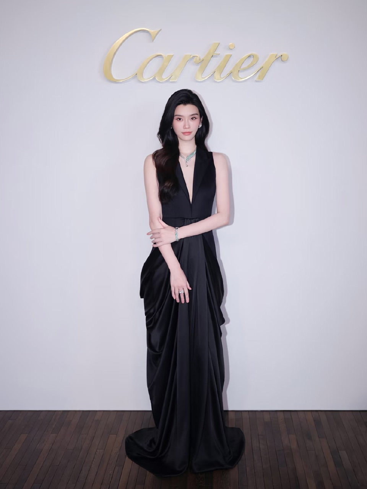

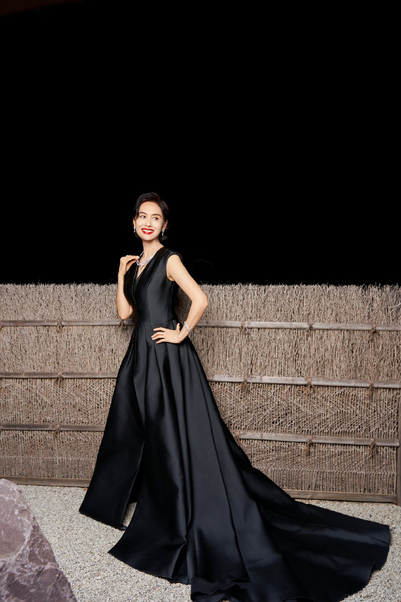

## 02 / 野帐，买了10本

*THINK OF THINGS / COPY CORNER LABEL PRODUCTS*

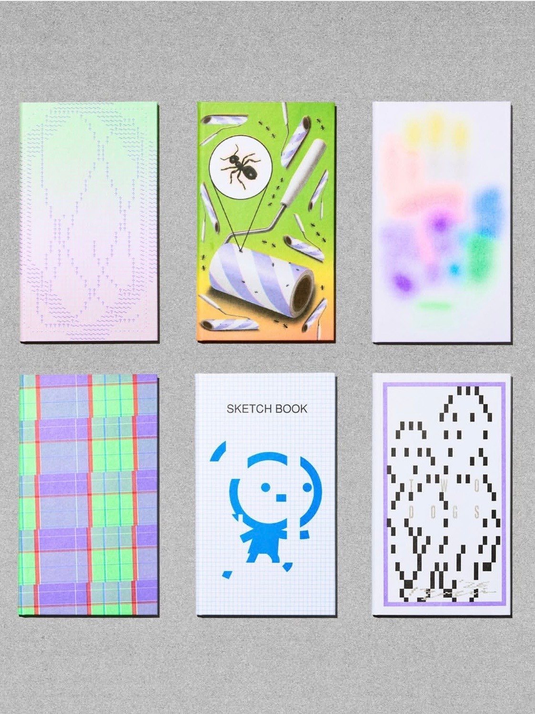

*RISO FIELD NOTEBOOKS*

10本

THINK OF THINGS 这批野帐，真的好喜欢，买了10本。

这是 COPY CORNER LABEL PRODUCTS 的 RISO 系列，六位创作者做了六款封面。同样一块窄窄的长方形，有人把方格拆开玩，有人画蚂蚁，有人干脆请你把本子合上休息。值得每款都看一下。

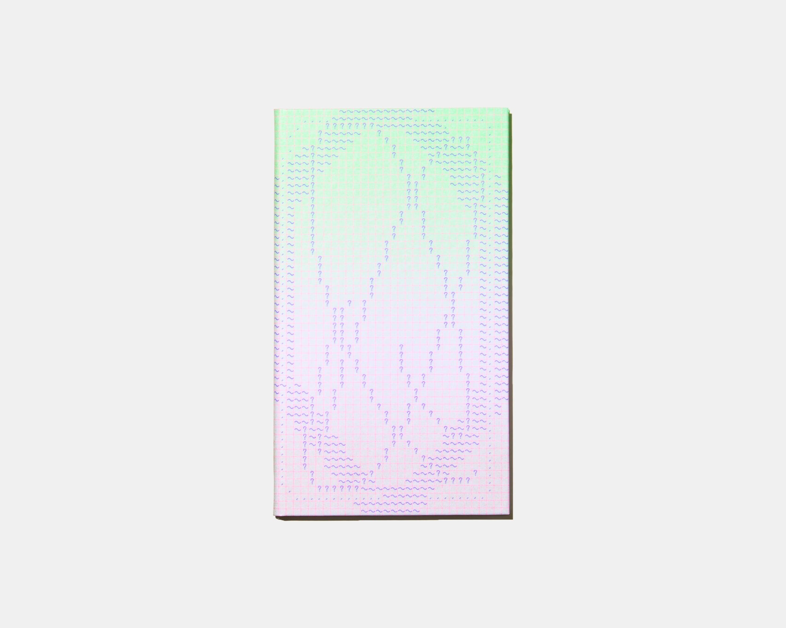

### 01 / 藤田紗衣 · 3×3

从内页的3毫米方格出发，用问号、感叹号、波浪号画画。细小符号排出疏密，大片空白从中间浮出来，底色从浅绿过渡到粉。很淡，却有东西可细看。把最普通的标点用成这个样子，很喜欢。

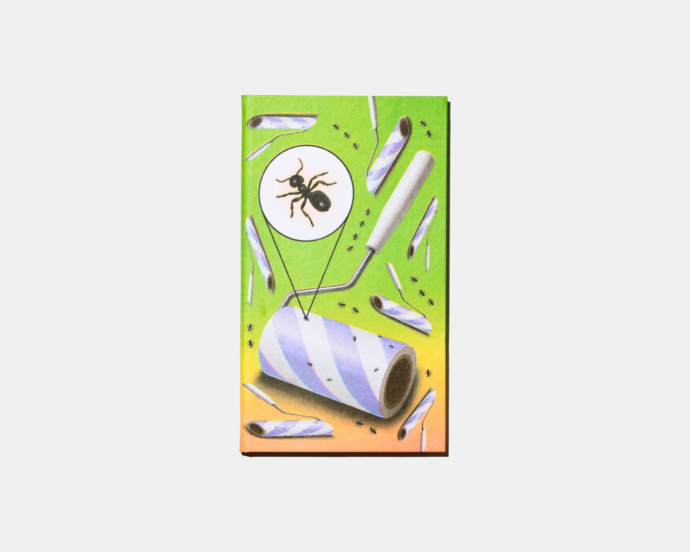

### 02 / nico ito · Viral Trap

亮绿底，紫白条纹的除尘滚筒，上面黏着蚂蚁，还有一只被圈起来放大。东西都认识，组合在一起就很怪，像一张不知道在推销什么的小广告。这本光看封面就想知道里面会写什么。

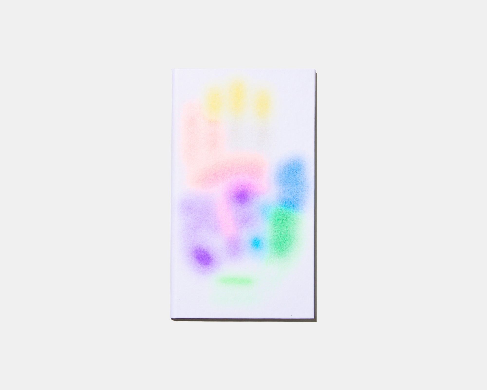

### 03 / 田中せり · 休憩野帳

粉、黄、蓝、紫晕在一起，原来是从手部穴位图发展出来的，用了10版渐变叠印。因为本子刚好能放在掌心，她想让工作的人合上本子，照顾一下身体。喜欢它把手的轮廓藏得很轻，颜色倒是很舍得用。

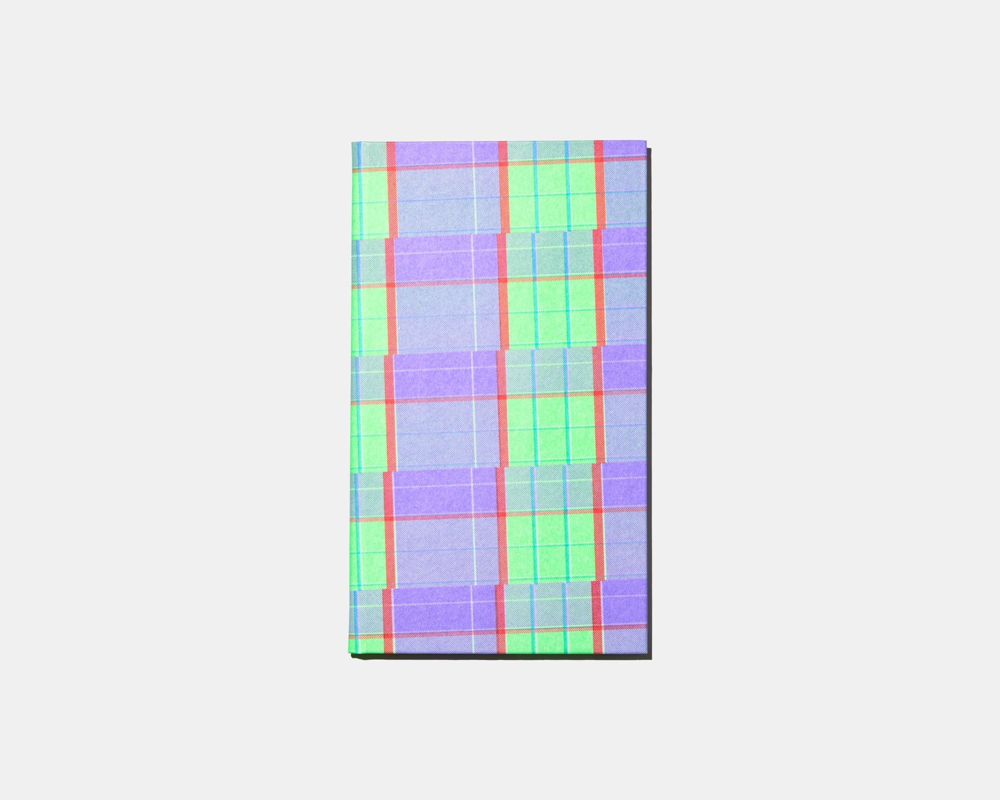

### 04 / 鳳崎優和 · RISO TARTAN CHECK

紫、绿、蓝的格子里插进细细的红线，RISO 套色的错位让整齐的格纹有一点晃。作者从野帐封面原有的布纹纸想到格纹，想让人像拿一件时尚配饰一样拿它。这种配色，做成衣服我也会想看。

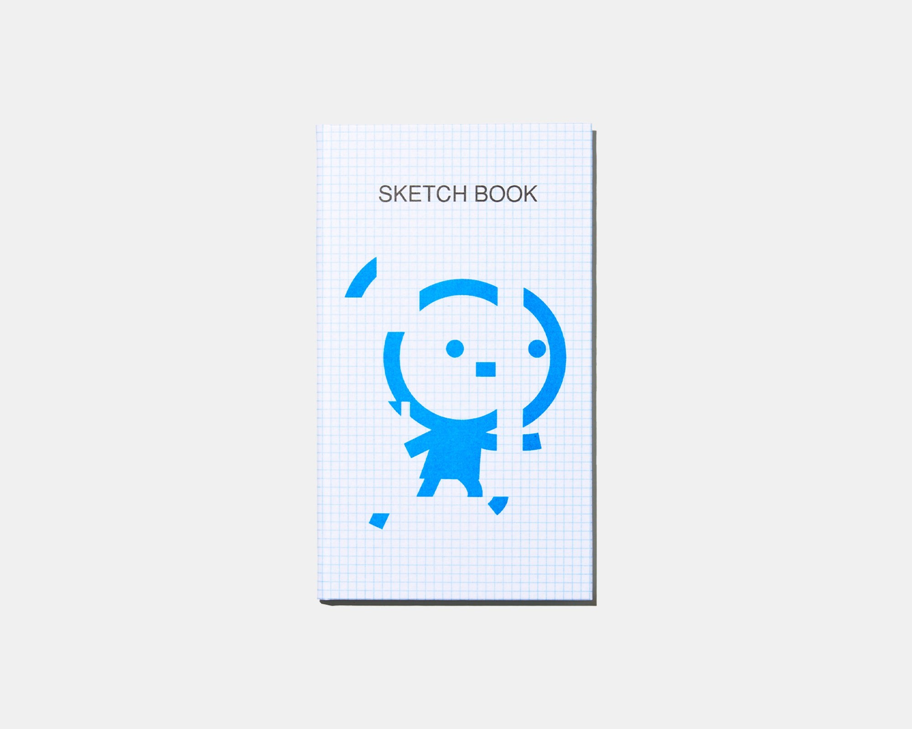

### 05 / 中村至男 · 方眼の森

一个蓝色小孩，头上的圆弧断开，身体也像由几块零件拼起来。背后留着很淡的方格，画面只用这一种醒目的蓝就够了。作者写的是小孩走进方格森林，散乱的念头慢慢连成网络。看着它，乱写乱画好像也很合理。

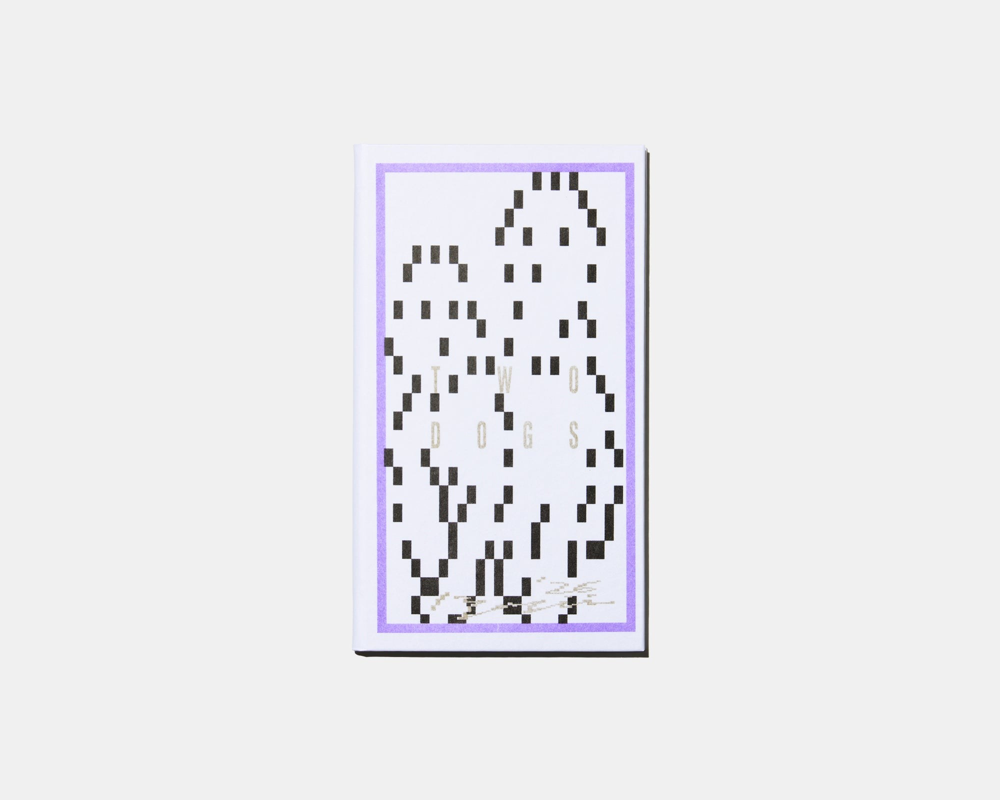

### 06 / 田中良治 · Taro & Jiro

黑色小格拼出两只狗，外面圈一条紫边。它们是塔罗和次郎，1959年在南极被发现幸存，恰好也是测量野帐诞生的年份，背面就印着紫色的1959。两件事被他连在一起，最后落到这么简单的图形上。知道以后，封面更好看了。

六款放在一起也好看。淡的真的很淡，亮的又很亮，没必要全都长得像一家人。

## 03 / 不滑雪，也照样穿

*SMALL THINGS / GOOD DESIGN*

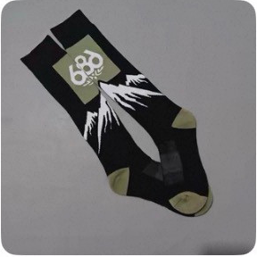

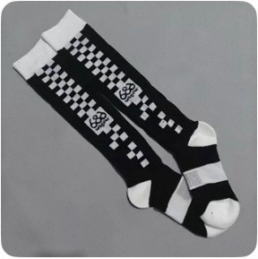

### 雪山从袜筒 往下冲。

686 的长袜子也买得很开心。绿色和黑色的大色块上，白色雪山直接从袜筒往下冲，脚尖、脚跟再用灰色或橄榄绿收一下。图案够大，轮廓够清楚，连袜子都做得这么好看。我不滑雪，照样穿，舒服又好看。黑白棋盘那双也好看，图案很直接。

## 04 / 杂志留下来剪

*PRINT MATTERS / COLLAGE NEXT*

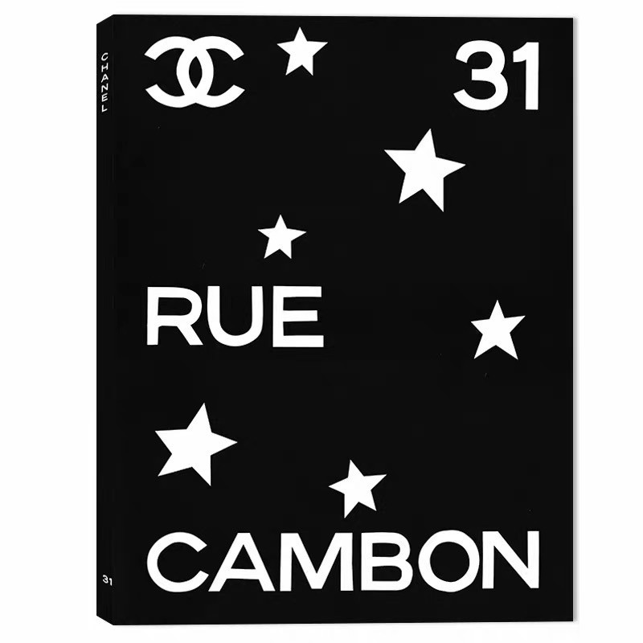

### 封面很好看。 内容嘛……

香奈儿这本，封面黑白，字大，星星也大，31、RUE、CAMBON 被拆开放，几乎从上排到下。封面很好看，内容嘛，没什么内容啊。

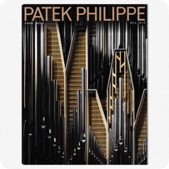

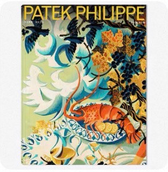

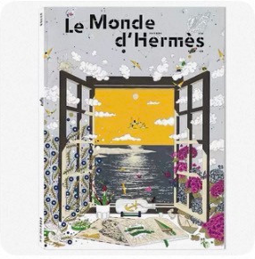

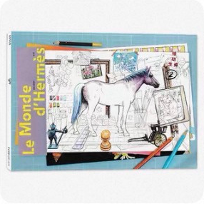

*INSIDE THE MAGAZINES*

### 内页也留下来看看

以下沿用之前的公开内页参考；不认定与上方封面属于同一期。

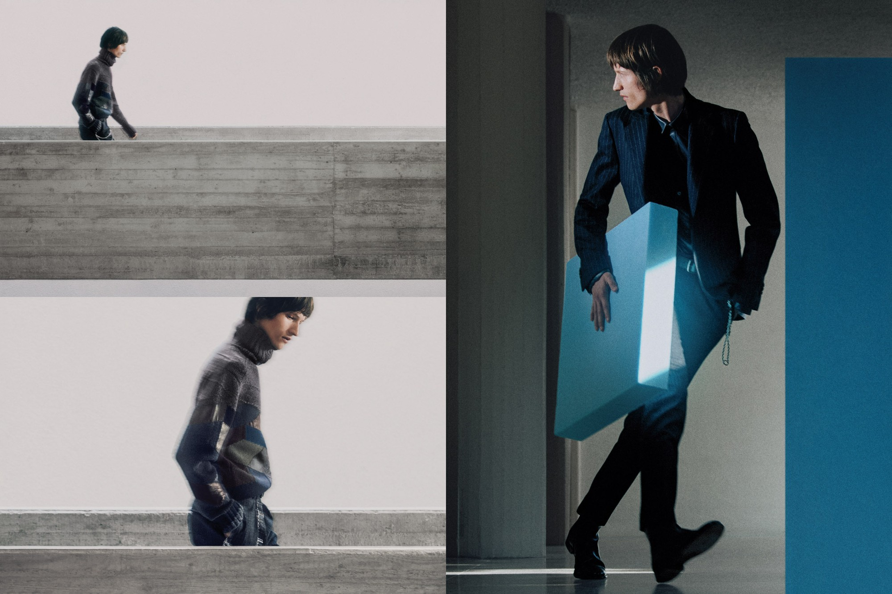

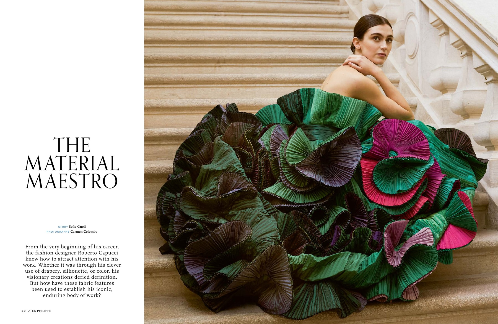

爱马仕、百达翡丽的新杂志，下次拿去拼贴活动给大家用。大片颜色、一个字、一小块衣服，都可以剪出来。到时候就不必照着品牌原来的意思看了，谁看上哪块，拿走。

## 05 / 最近用的和想用的 AI

*TOOLS / CURIOSITY / EVERYDAY WORK*

*01 / CONNECTION*

### Pinku

Pinku 这个想法挺有意思，连交友都可以先让双方的 AI agent 牵线。好奇它会怎么介绍我，又会从另一个人的资料里挑出什么。尤其是那些自己觉得很要紧、别人却未必在意的细节，交给 agent 会发生什么？

### 摇醒实验室 × Codex

还有摇醒实验室的资料，想让 Codex 学一遍，顺便帮我重新回顾设计。有些东西当时看过，过一阵子再看，想问的问题也会变。想看看现在拿这些资料和它讨论，会聊出什么。

*02 / ACTUAL WORK*

### Grok Bot

最近全换 Grok Bot 了。我现在用着不用挂梯子，还能自动上架淘宝产品，真爽。前面那些还在好奇，这个已经在替我干活了。

## 06 / 最后，放一个好看的网站

*ONE MORE GOOD THING*

### twomuch.studio ↗

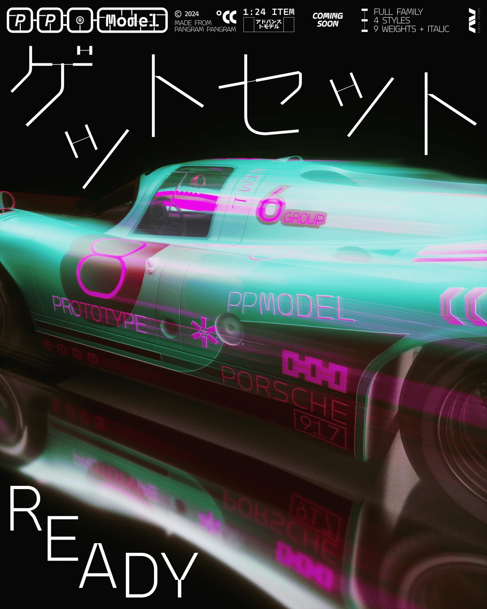

最后放一个真好看的网站，twomuch.studio。

PP Model 那组，黑底、亮青色赛车、品红色的光，字也拆得像模型零件。它给字体做发布视觉，连模型车的注塑板、贴纸、说明书都成了设计线索。喜欢这种做法，一个想法可以一直做进去，换到不同画面里还有得玩。

[打开 twomuch.studio ↗](https://www.twomuch.studio/)

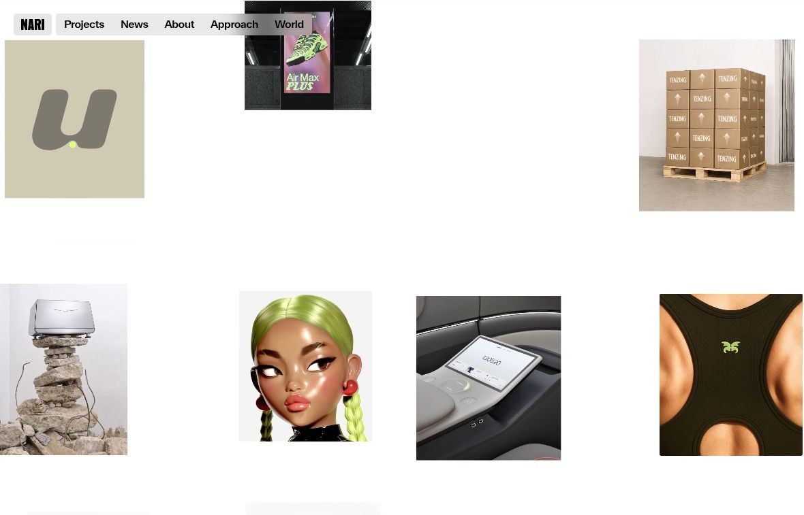

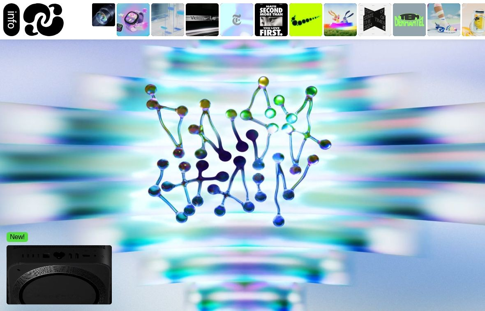

它给 Studio Nari 做的网站又很空，图片大小不一，彼此离得远，白色一路漏出来，眼睛可以在图块之间跳。Daisy Chain 则把缩略图挤成顶上一长条，下面整块屏幕留给作品；细细的导航条对着巨大画面，比例很痛快。同一家工作室，排法完全不同，这两个都值得点进去看。

10月先记这些。下次拼贴，记得带杂志。

## 图片来源

1. **用户提供图片** — Peggy Gou两张完整图集、野帐款式图、686两款长袜、CHANEL封面，以及Patek Philippe和Le Monde d’Hermès共四本封面；不标为自拍，不推断未确认刊期。

2. **SONG OF SONG** — 奚梦瑶与朱茵官方明星造型，仅作品牌参考，不代表作者购入款。 [来源 ↗](https://weibo.com/2/detail/5334715742814795)

3. 黄宣 — 两套造型分别来自 HEAVEN RAVEN 2022 本人专访及 Vogue Taiwan 2023 专题；品牌信息见图注。 [HEAVEN RAVEN 来源 ↗](https://www.heavenraven.com/2022/01/18/singer-artist-yellow-interview/) / [Vogue 来源 ↗](https://www.vogue.com.tw/entertainment/article/ecover-yellow)

4. **THINK OF THINGS** — 六款RISO测量野帐官方产品图及设计说明。 [来源 ↗](https://think-of-things.com/collections/features32)

5. **Le Monde d’Hermès** — 第89期（2026）影像，来源摄影师官方经纪公司Mini Title。 [来源 ↗](https://www.minititle.com/news/daniel-shea-shoots-for-le-monde-dhermes)

6. **Patek Philippe Magazine** — Vol. V No.8，2026。采用公开内页，不确认作者手头的具体期号。 [来源 ↗](https://www.patek.com/en/owners/magazine-extra)

7. **Pinku** — 公开首页截图，未展示个人档案或聊天记录。 [来源 ↗](https://pinku.chat/zh/)

8. **Grok Bot** — 官方首页截图；淘宝上架与网络使用情况为作者个人使用体验。 [来源 ↗](https://x.ai/bot)

9. **Twomuch Studio** — PP Model项目官方原图；项目与网站链接。 [来源 ↗](https://www.twomuch.studio/projects/pp-model)
